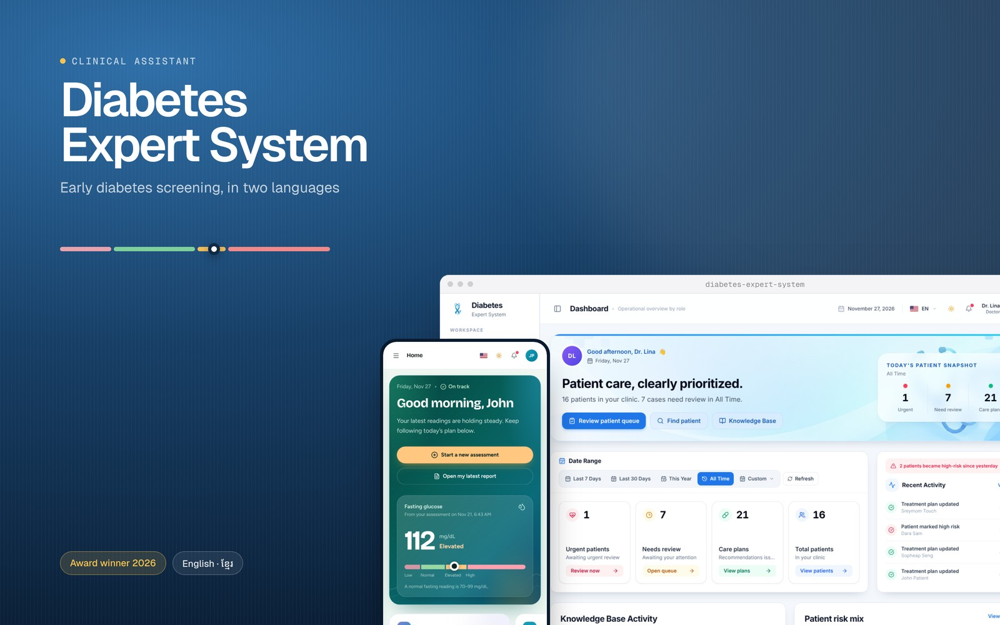
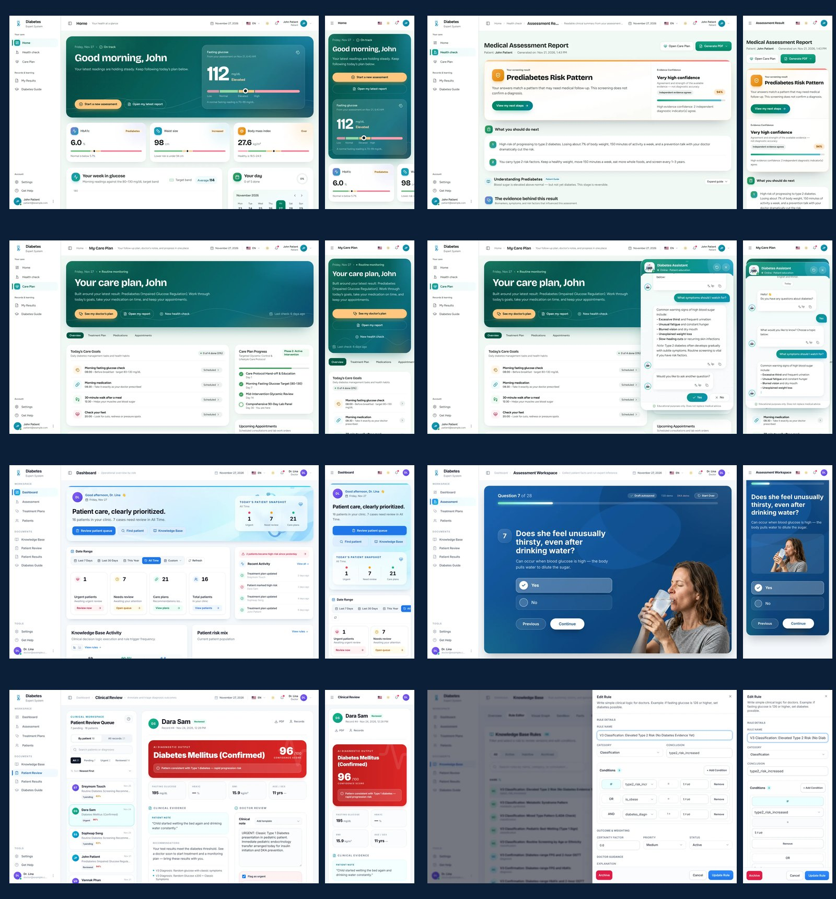

# Portfolio kit: Diabetes Expert System

Everything needed to add this project to the portfolio (Danish_portfolio), in the same
shape as the Bookly case study. Captured from the real app with demo data on 27 Nov 2026.

## What's here

| Path | What it is | Size |
| --- | --- | --- |
| `cover/card.webp` | Project card cover (16:10), with title, award and language tags | 3200×2000 |
| `cover/banner.webp` | Wide banner for the top of the case study (2.4:1), no title | 3840×1600 |
| `cover/*.jpg` | Same covers at half size, for LinkedIn, README or slides | |
| `cover/cover.source.html` | Source of both covers, if a change is ever needed | |
| `screens/*.webp` | 14 screens, each on laptop and phone | laptop 1440×900, phone 516×1118 |
| `diabetes.portfolio.ts` | Ready-to-paste portfolio entry: pitch, problem, what I built, screens, numbers, future plan | |
| `overview.jpg` | All main screens on one page, for a quick look | |

The sizes match the Bookly screenshots already in the portfolio, so both case studies line up.

## The story (also in `diabetes.portfolio.ts`)

**Pitch.** Answer a few questions in English or Khmer, see your diabetes risk and the reasons
behind it, and get a care plan your doctor has checked.

**The problem.** Early diabetes is easy to miss. Most screening tools are English-only and
give a score with no reason why, and doctors have no quick way to see who needs them first.

**What I built.** A screening assistant in both languages: a guided check-up, a result that
shows its evidence, a review queue for doctors, and a care plan the patient can follow.

**Numbers** (checked against the code): 59 clinical rules · 99 clinical facts ·
219 backend tests passing · 2,695 strings in both English and Khmer.

**Future development plan**
- Dark mode on every screen
- Glucose reminders on Telegram
- Install it on a phone and use it offline
- Check the rules with doctors on real, anonymised cases

**Facts row:** Team of 4 · Award: AI Expert System 2026 · English · ខ្មែរ · 59 explainable rules.

## Screens

Every screen has a laptop file (`name.webp`) and a phone file (`m-name.webp`).

| Group | Screen | File |
| --- | --- | --- |
| Patient | Home: today's glucose on a colour band | `patient-home` |
| Patient | Result with reasons and confidence | `result` |
| Patient | Care plan: goals, medication, appointments | `care-plan` |
| Patient | Dr. Bot answering a question | `assistant` |
| Patient | Home in Khmer | `patient-home-km` |
| Patient | Diabetes guide | `guide` |
| Doctor | Dashboard | `doctor-home` |
| Doctor | Guided assessment, with pictures | `assessment` |
| Doctor | Review queue: urgent case with doctor's note | `review` |
| Doctor | Patient record | `patient-record` |
| Doctor | Knowledge base overview | `rules` |
| Doctor | Rule editor (IF / AND / OR) | `rule-editor` |
| Admin | Roles & permissions | `admin-roles` |
| (extra) | Landing page | `landing` |

## Adding it to the portfolio

1. Copy `screens/*.webp` into `src/assets/projects/diabetes/` and the covers next to the other covers.
2. Add the `diabetes` image lookup to `src/lib/assets.ts` (the exact lines are at the top of
   `diabetes.portfolio.ts`).
3. In `src/content/portfolio.ts`, replace the current `diabetes` entry with the one in
   `diabetes.portfolio.ts`, and map each screen name through the lookup.
4. Widen `CaseStudy.screens[].group` to include `"Patient" | "Doctor"`.
5. The "How I built it" blocks (`steps`, `practices`, `challenges`, `lessons`) are empty on
   purpose. Hide a block when its list is empty, so no empty headings show.
6. `ProjectCover` draws the Bookly devices only for `id === "bookly"`. Either use
   `cover/card.webp` as the diabetes cover image, or add the same laptop + phone branch for
   `diabetes` with `doctor-home` and `m-patient-home`.

## Notes

- All names and records in the screenshots are the app's built-in demo data. No real patients.
- The demo notice pill and the floating assistant button are hidden in the screenshots,
  except on the Dr. Bot screen, where the assistant is the subject.
- Role line: the current portfolio says "I contributed Google sign-in, UI improvements, and
  testing." It's kept that way in `summary`. Change it if your part grew.
